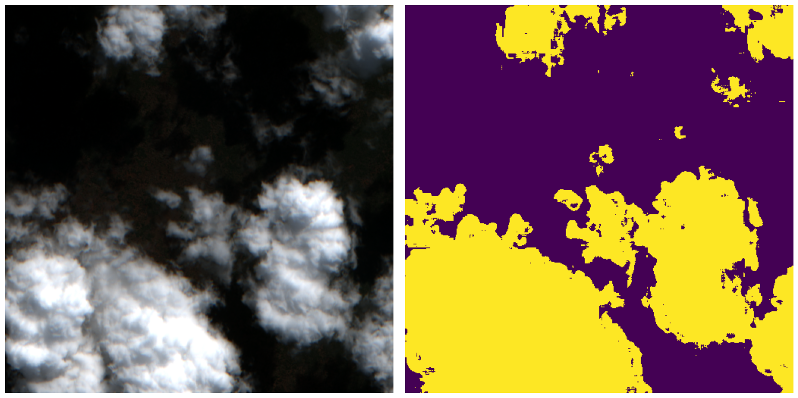

This repository contains a proposal for the IVPL challenge, focused on binary image segmentation for cloud detection.
As required by the challenge guidelines, the workflow was initially developed and executed on Google Colab. This is a late upload on GitHub.

The main file, `IVPL_challenge.ipynb`, contains the complete pipeline, including:

* Data preprocessing and normalization
* A lightweight Fully Convolutional Network (FCN) model definition
* Model training and TFLite conversion for edge deployment
* Inference and mask visualization

For more detailed explanations refer directly to the markdown cells and comments inside the `IVPL_challenge.ipynb` notebook itself.

